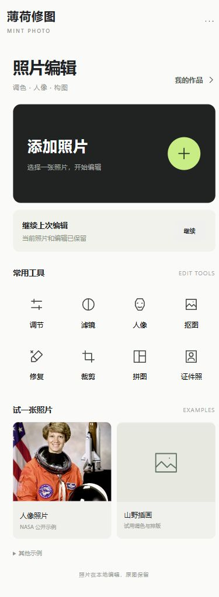
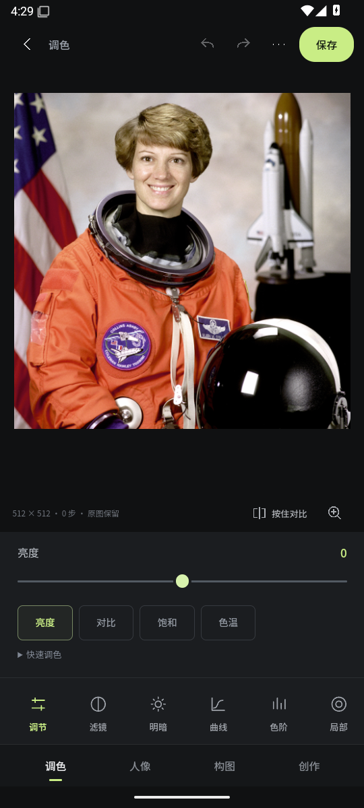

# 薄荷修图 · Mint Photo

把一张日常照片，慢慢调成自己喜欢的样子。

薄荷是一款在设备上处理照片的修图工具，把日常调色、构图、人像精修和创意排版放进同一个工作区。无需登录，也没有广告；可以随时对比原图、撤销修改，并把作品保存在本地继续编辑。

**当前提供 0.3.1 开发预览（APK 0.3.1-dev），不是正式版。** 这一版按官方界面参考重新组织手机编辑器：深色画布、底部四类工具、单参数长滑杆。浏览器可体验日常修图与手动精修；自动人脸识别与人物分割依赖 Android 本地模型。

[下载 0.3.1 开发测试包](https://github.com/shiyan688/mint-photo/releases/tag/v0.3.1-dev.1) · [设计参考与界面验收](docs/UI-DESIGN-RESEARCH.md) · [上一版 0.3](https://github.com/shiyan688/mint-photo/releases/tag/v0.3.0-dev.1)

左为浏览器手机尺寸首页，右为 Android API35 模拟器的实际编辑画面，均为应用运行截图。

<p></p>

## 后续功能开发

[与醒图的56项差距台账](docs/XINGTU-GAP-MATRIX.md) · [本轮实际进展与验证](docs/FUNCTIONAL-PROGRESS.md)

当前开发分支为0.3.1-dev：新增自动光线、浏览器批量调色，安卓/浏览器共用的自填API、涂抹消除与四边扩图链路，以及试验性的纹理修肤/边缘贴合。Android API35模拟器已通过自填测试配置→消除/扩图→系统保存→重新打开，以及错误/取消重试；设备保存PNG另有独立核对。**真实AI出图、实体手机性能与修图质量仍未验收，不能算AI效果已完成**。已发布0.2测试包不包含这些增量。

[安卓AI与照片验收记录](docs/AI-ANDROID-QUALITY.md) · [性能、简化界面与4张真实照片回归](docs/PERFORMANCE-UI-QUALITY.md) · [新版安卓模拟闭环证据](docs/quality/android-ui-e2e-20261025/README.md)

## 可以做什么

| 你想做的事 | 薄荷提供的工具 |
| --- | --- |
| 给日常照片调个舒服的颜色 | 滤镜、明暗与白平衡、曲线、HSL、RGB 色阶、局部调色、锐化 |
| 把构图整理干净 | 裁剪、旋转、翻转、任意角调平、四角透视、边框与留白 |
| 认真修一张人像 | 手动修复与液化；Android 端可识别人脸后逐人调整，并涂抹保护本轮美颜 |
| 做一张分享图 | 多行文字、图片叠加、符号、涂鸦、2–4 格拼图 |
| 整理背景与证件照 | 手动保留/擦除与修边、透明/纯色/照片背景、证件照尺寸与构图 |
| 下次接着修 | 编辑步骤、撤销/重做、本地作品库、调色配方、`.mintproject` 工程备份 |

导出支持 **JPG / PNG**、JPG 画质与最终长边设置。原照片保留，图片导出后可直接分享。完整能力与浏览器/Android 区别见 [功能说明](docs/FEATURES.md)。

## 在电脑上试用

下载源码并解压，在项目根目录打开终端。安装 Python 3 后运行：

```sh
python -m http.server 8080 --bind 127.0.0.1 --directory app/src/main/assets
```

浏览器打开 [本地编辑器](http://127.0.0.1:8080)。Windows 也可以把命令中的 `python` 换成 `py`。

1. 选择一张照片，或使用内置示例。
2. 调整参数后点击「应用修改」，通过按住「对比原图」比较。
3. 点击右上角「保存」导出图片；想以后继续修改，可在「更多→作品库」保存工程。

照片处理在本地完成，启动本地服务后不需要互联网。建议一直使用同一地址和端口，方便找到该浏览器里的作品；更换浏览器或清除站点数据不会迁移作品，重要作品请额外导出工程备份。

## 人像功能与 AI

Android 工程包含 MediaPipe 人脸关键点和人物分割模型。模型提供人脸位置与初始人物蒙版，修肤、调色、塑形和手动修边由本地算法完成。普通浏览器没有 Android 桥，因此不会运行自动识别；仍可使用日常工具与手动精修。

它目前适合可控地修图，不承诺生成式换脸、发丝级抠图或失焦细节恢复。复杂遮挡、逆光和发丝边缘需要人工检查。证件照工具提供构图与尺寸，不代表自动满足所有证件受理要求。

## 开发与 Android

前端使用原生 HTML、CSS、JavaScript 和 Canvas，不需要安装前端依赖即可本地预览。Android 端使用 Java、WebView 和随包提供的离线模型，当前源码要求 Android 8.0 及以上。

```text
app/src/main/assets/   编辑器、像素算法、模型与示例
app/src/main/java/     Android 桥接、导入导出与模型调用
tests/                核心、状态、边界及集成测试
docs/                 功能、构建与验证说明
marketing/            小红书文案、抖音分镜与发布素材说明
```

可先运行一组不需要 Android SDK 的核心回归：

```sh
node --test tests/geometry.test.cjs tests/project-core.test.cjs tests/export-size-core.test.cjs
```

完整公开回归使用 Node.js 24 和 JDK 17，运行 `node tests/run-ci.cjs`；范围见 [CI 说明](docs/CI.md)。历史私有照片审计不随源码分发，合成夹具与核心回归仍保留。Android 构建与预览产物见 [ANDROID.md](docs/ANDROID.md)。

## 保存与分享

导出的 JPG/PNG 是最终图片。工程文件保留原照片、编辑历史和内嵌素材，未加密；分享经过遮盖的图片时，请分享检查后的导出图，不要分享工程文件。

欢迎反馈具体的操作步骤、设备/浏览器版本和期望结果。提交示例前请先移除私人信息。

[0.2 发布说明](docs/RELEASE-NOTES-0.2.md) · [功能说明](docs/FEATURES.md) · [第三方组件与素材](docs/THIRD-PARTY-NOTICES.md) · [公开分发范围](docs/PUBLIC-DISTRIBUTION.md)

目前是公开源码预览，尚未为项目自有代码指定开源许可证；第三方组件继续适用各自的许可。公开可读不等于已授予 MIT 等开源许可。
