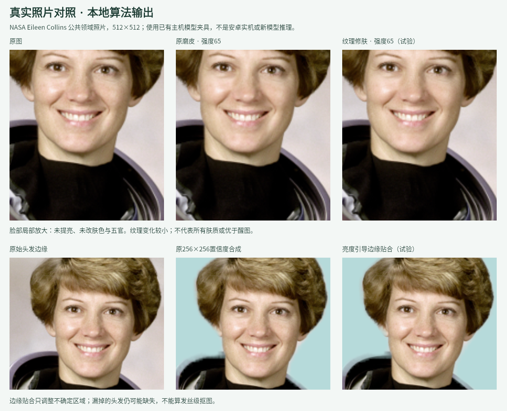

# 安卓 AI 与真实照片验收记录

2026-10-25增补：0.3.1-dev / versionCode 6重做界面后，API35模拟器完整流程重新通过83项检查、独立保存PNG核对7项通过，见[新版证据](quality/android-ui-e2e-20261025/README.md)。真实AI服务、实体手机和照片质量的未验收状态不变。下面保留0.3.0-dev历史细节。

日期：2026-10-24；开发版本0.3.0-dev（versionCode 5）。当前提供0.3开发预览，0.2保留为历史包；本记录不宣称达到醒图水平。

## 代码已经接通的部分

安卓使用独立原生HTTPS任务，用户填写完整Images Edits地址、模型和API Key，勾选上传同意后发起请求。WebView本身继续禁止网络；新增INTERNET普通权限仅用于原生请求。不保存密钥、照片请求或供应商响应到日志/磁盘，不跟随重定向。20秒连接超时、180秒任务超时；关闭界面、切到后台、页面重载、Activity销毁均取消请求。旧请求不能覆盖新请求；取消不保证第三方尚未计费。

- **消除**：照片上实际涂抹，最多64笔，可撤销/清空。生成同尺寸PNG alpha蒙版（透明处可改）；模型返回后，本地只合成选区，未选区域保留原像素。
- **扩图**：四边各0–50%，实际扩展透明画布并生成PNG蒙版；结果只填入新增区域，中心原图保留。可能出现接缝，必须检查。
- **文字编辑**：不加选区限制，允许整张改变；明确区别于消除。
- **结果流程**：先预览，确认另开新照片，沿用原有作品保护/保存流程。没有伪造模型结果或把普通修复画笔当AI消除。

仅兼容multipart `images/edits`、Bearer认证、`data[0].b64_json` PNG返回；不支持Chat Completions、URL结果下载或所有厂商协议。消除/扩图要求服务支持mask、输出保持请求宽高比（相同比例可缩放）；比例不符时拒绝合成，避免错位。图片与蒙版合计12MiB、画布800万像素/4096最长边。用户不应把密钥发到聊天或提交到仓库。

接口依据：[OpenAI Images Edits参考](https://developers.openai.com/api/reference/resources/images/methods/edit)、[图像编辑与蒙版要求](https://developers.openai.com/api/docs/guides/image-generation)。兼容接口不代表已经与任意供应商实测。

## 本地人像算法增量

- “人像→纹理修肤·试验”：独立detail-v2引擎，使用受皮肤置信度/五官保护限制的双尺度分解，保留部分细小纹理；美颜操作明确保存为版本3。旧portrait-engine.js仍保持原始SHA-256，旧工程不会悄悄改效果。
- “背景→边缘贴合·试验”：对蒙版不确定部分使用照片亮度引导滤波，768长边工作网格、原尺寸合成；蒙版接近0/1的确定区域保持原值。明确版本2操作，默认关闭。没有换新分割模型，也不能恢复所有漏掉的头发；低对比背景、逆光和复杂发丝仍可能失败。

## 已验证的证据

|检查|结果|范围|
|---|---|---|
|公开逻辑回归|1676项通过，0失败|不是浏览器或手机验收|
|原生HTTPS模拟连接|17项检查通过|实际Java multipart、UTF8、蒙版、认证、重定向拒绝、取消、响应上限；没有真实模型|
|工程原生静态检查|37项通过|WebView网络隔离保留；不是手机运行|
|Android构建/lint|ARM64、ARM32通过|可构建，不等于可用性验收|
|APK资源/签名/16KiB对齐|94份资源字节一致，构建产物检查通过|不包含手机安装或保存|
|真实照片像素重放|旧单照片记录保留，另有4张真实照片新模型推理与产品核心输出|无醒图同图结果或抠图真值，侧脸漏检/持物误抠仍存在|
|安卓模拟器完整闭环|API35/x86_64，34项检查通过|实际WebView触屏、原生HTTPS模拟服务与系统保存/重开；不是真实AI或实体手机|
|实际保存PNG独立检查|7项通过|512不透明样例的消除保护区域、716扩图原中心、保存重开均零差异；不推广为所有图片无损|
|真实浏览器界面|NASA照片涂抹出现选区；撤销入口、四边参数与716×716透明边缘预览可见|没有发送外部请求，没有测试实际模型返回后的浏览器保存|

真实素材使用随应用分发的NASA Eileen Collins照片，SHA-256已校验，详见[第三方声明](THIRD-PARTY-NOTICES.md)。以下旧单照片记录使用已有MediaPipe主机检测夹具；后续对4张真实照片重新做了主机CPU推理，见[多照片记录](PERFORMANCE-UI-QUALITY.md)，两者均不能冒充安卓检测结果。修肤强度65，仅改变4406个像素，最大通道差6/255；指定脸部以外的左侧区域保持不变，透明度保持不变。变化较小，不能据此称为显著提升或比醒图更好。抠图合成20241个像素有变化，但没有真值，不能把“变化”当作准确率提高。

另外用真实照片加纯洋红色**模拟返回**，只检查本地合成：257316个未选像素逐字节保留；扩图中心512×512逐像素保留，错误宽高比拒绝。洋红色负对照不是AI生成照片，不作为AI效果宣传。合成高对比边缘测试验证引导蒙版朝已知边界改善，仅代表该合成条件。

[像素记录与输出哈希](quality/real-photo-20261024/report.json)。原始图、旧修肤、新修肤、旧抠图、新抠图PNG均在同一目录。复现：安装`@napi-rs/canvas`后，配置可用CJK字体路径到`MINT_TEST_FONT`，运行`node tools/verify-photo-quality.cjs`。该脚本不会访问AI服务。

## 仍不能算完成的项目

1. **真实AI消除/扩图出图**：没有可用服务凭据，未发送实际供应商请求。代码链路和模拟检查已完成，真实功能验收未完成。
2. **实体手机验收**：API35模拟器已完成测试配置→实际触屏消除/扩图→返回→接受→系统保存→源图片安装标识改变后重新打开，另测401、比例错误和取消后重试；[完整证据](quality/android-ai-e2e-20261024/README.md)。实体手机、软键盘、大图、透明图重复保存、弱网、切后台和内存峰值未验收，不以模拟器代替。
3. **修肤/抠图质量**：已有4张真实照片新推理与前后对照，但仍有侧脸漏检、头盔误抠、背景残留；缺更广场景、标注真值与竞品同图盲评。继续标记试验，不标记醒图级或发丝级。
4. 旧台账的自动美体、整套妆容、超清修复、RAW/HDR、高清细节预览、安卓批量保存等仍未解决。

## 在手机上验收的方法

安装本分支0.3.0-dev的Debug包，先用公共示例，进入“更多→联网AI工具”填自己的HTTPS图像编辑地址/模型/密钥。确认服务支持PNG mask与输入比例后，分别试消除一小块背景和四边扩展；检查非选区、面部、边缘接缝。接受为新照片后导出PNG，用系统相册重新打开核对尺寸和内容。再测关闭、切后台、断网、错误密钥及重试。只有这套闭环和实际效果通过后，才能把对应项改为完成；请不要把API Key发到聊天里。

[最新性能/界面记录](PERFORMANCE-UI-QUALITY.md) · [安卓完整模拟闭环、原始PNG与截图](quality/android-ai-e2e-20261024/README.md)。0.2历史包不包含上述增量，以上对应0.3开发预览。
