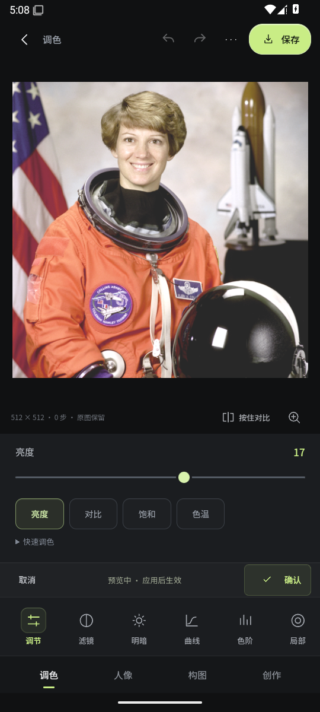

# 0.3.2 按钮细化记录

日期：2026-10-25；应用源码 `608c61afb94bfe834be79a44b578e4f19b85ebee`，versionCode 7。延续0.3.1已验收布局，只调整按钮表面、图标和状态。

- 保存按钮增加导出图标、细描边和轻微内高光。
- 当前工具的图标增加淡色底座；参数选中态使用更清楚的边框与底色。
- 确认按钮增加勾选图标与薄荷色浅底；按下时改变表面颜色，常用按钮的点击盒子不位移。
- 本轮新增的悬停细节只对精确指针启用，禁用保存按钮维持静态；工具和参数的键盘焦点改为内描边，避免被横向滚动容器裁切。
- 新过渡仅涉及颜色、描边与小阴影，时长120ms；没有新增背景模糊或图像重算。代码处理prefers-reduced-motion，此轮未切换系统偏好做运行时验收。

## 已完成的验证

[浏览器原始记录](quality/button-polish-browser-20261025.json)：360×640、390×844、915×412、1360×1000四种CSS尺寸，检查的16个目标均至少40 CSS像素、在视口内且无遮挡；无横向页面溢出。实际应用一次亮度后撤销、重做，再打开保存对话框均通过。键盘Enter选择参数后焦点环可见，计算样式为2px薄荷色内描边。

[浏览器实际截图](assets/button-polish-editor.png)使用公开NASA方形512样例，亮度预览1；用于展示按钮，不是算法质量对比。

本机ARM构建与lint、两架构签名/16KiB对齐、94个打包资源逐字节一致校验通过，见[构建报告](quality/button-polish-build-20261025.json)。云端1686项逻辑测试通过；本轮Android模拟器首次在归零后出现测试误点，[失败记录](quality/button-polish-native-failure-20261025.json)与[原始画面](assets/button-polish-failed-neutral.png)保留。修正自动点击定位后，[最终回归](quality/button-polish-android-20261025/README.md)通过97条流程/布局检查记录，27次真实触摸均命中预定目标，独立实际保存PNG核对7项通过。测试源码964486e，应用源码仍为608c61a，未为通过测试放宽产品逻辑。

未改变修肤/抠图或图像引擎。此轮没有实体手机、真实AI、触摸手感或性能对比验收。

