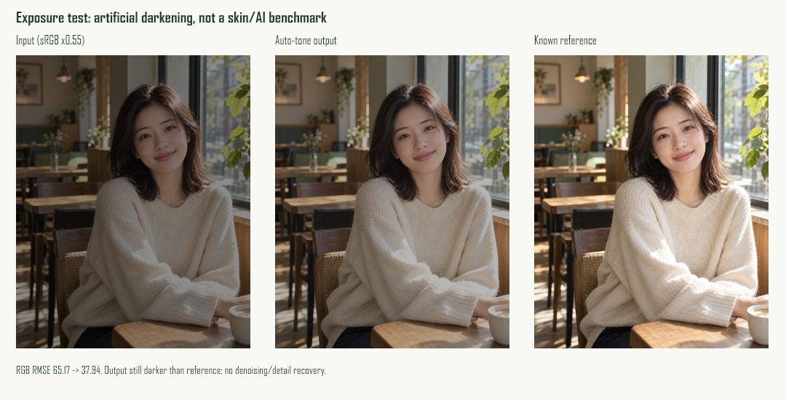

# 第一批功能与效果改进记录

日期：2026-10-24。基于0.2.0预览，尚未达到醒图整体水平；不修改旧发布包来冒充新版本。

## 已实现的增量

- **自动光线**：在“明暗/白平衡”内，按alpha加权亮度分布，生成保守的阴影/高光/等通道增益。照片层次不足或已合适时可不改变。不推断肤色、不做高光重建。保存的是既有light-balance操作，支持当前历史/备份格式。
- **批量调色**：普通浏览器选择1–20张照片，独立串行处理，同滤镜/逐图自动光线、JPG输出、ZIP下载；有取消、部分失败与资源上限。只支持这部分工具，不是完整编辑步骤批量同步。Android保存还没接入。
- **用户自填API**：HTTPS完整Images Edits端点、模型和密钥，显式同意后发送工作尺寸PNG；结果先预览，确认另开新照片。普通浏览器须运行专用Node服务。未使用真实服务，因此模型效果仍未验证。

## 效果验证

10项新增测试覆盖光线、透明度、批量顺序/取消、ZIP CRC及模拟API请求/失败/取消。完整公开回归1655项通过。旧预览一致性测试仅修正了Windows CRLF与HTML解析LF归一化，不跳过算法检查。

两份图像以已知参考人工压暗（sRGB乘0.55），实际像素引擎输出后RGB RMSE：NASA样例63.19→36.44；原创AI咖啡馆样例65.17→37.94。它证明限定条件下往参考亮度移动；不能代表真实低光恢复、学习型修肤或与醒图等效。目检仍偏暗，暗部噪声也没有专门去除。原始数字见 [指标](quality/auto-tone-20261024.json)。

批量核心生成的两份ZIP由Python zipfile独立检查CRC、3个PNG内容通过；浏览器面板已检查，尚未完整跑系统多文件选择和下载流程。API仅模拟供应商与真实本地HTTP防护验证，没有发送照片到外部服务或产生费用。Android真机未验收。

## 用户自填API启动

需Node.js 24+，在项目目录运行：

```sh
node tools/ai-preview-server.cjs
```

打开 http://127.0.0.1:8790，导入照片并应用编辑，再点“联网AI”。填完整HTTPS `/v1/images/edits` 地址、该服务支持的模型、API Key和编辑说明。仅兼容multipart图像编辑并返回`data[0].b64_json` PNG的服务，不支持Chat Completions或任意厂商协议。没有内置账户或公用密钥。

接口协议参考 [官方Images Edits文档](https://developers.openai.com/api/reference/resources/images/methods/edit)。本地代理不写入请求日志或照片/密钥文件；密码输入每次请求及关闭后清空。内存中处理不代表第三方服务不保留内容，费用和数据政策由用户选择的服务决定。取消请求也可能已有服务费用。该服务器仅用于个人本机，不作为多人云代理部署。

离线静态页/安卓WebView仍保留connect-src none与网络封锁；仅Node服务响应中的HTML允许连接自身本地代理。安卓未接入联网API，界面明确提示。

## 未完成

56项台账尚需醒图Android逐菜单核实；人像学习型修肤、自动祛斑祛痘、自动美体、发丝matting、高清预览/导出、降噪、生成式消除/扩图/修复和Android端新功能验收都继续在待办。没有功能完成率或效果接近百分比。




Android两ABI debug编译和lint通过，89份资源与源码字节一致；这仅为构建检查，不包含手机安装运行。
