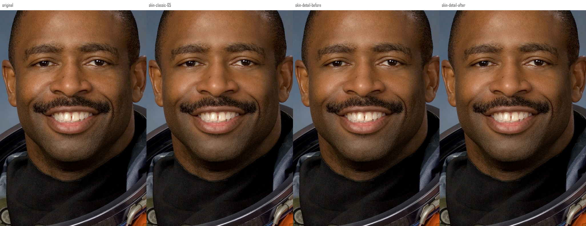
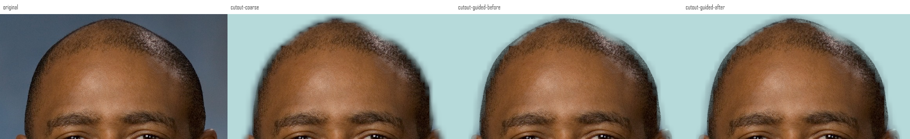

# 大图性能与安卓保存验证

日期：2026-10-28。开发预览 `0.3.4-dev` / versionCode 9。本轮保持现有界面，集中处理大图计算与取消、重开、保存流程。**处理速度有改善；修肤和抠图的成片质量没有因此提高。真实 AI 出图和实体手机性能仍未验收。**

## 本轮改动

- 打开 AI 工具时直接接收独立工作画布，移除一次 PNG 编码、Base64 和解码往返；没有借用或释放原照片画布。
- AI 上传前异步编码 PNG，取消后不发送；旧编码结束不能清空新请求的密钥、同意状态或解除其锁定。准备失败释放本轮画布；已开始的 PNG 编码无法中断，取消后待编码回调结束释放，快速反复关闭／重开时的内存峰值仍待测。
- 消除和扩图合成时，保护像素直接复制四个通道，避免每个像素都创建临时数组。输出像素保持不变。
- 扩图超过 800 万像素时显示原因并禁用发送，调回允许范围后可继续；不暗中缩小尺寸。
- 纹理修肤跳过脸部有效蒙版外的计算，复用皮肤置信度；边缘贴合共享插值坐标。保留原浮点运算顺序，旧工程与本次优化前的输出不变。

## 真实大图与测量范围

使用 NASA `jsc2007e036047` 的 **2400 × 3000 原始 JPEG，720 万像素**，不是放大小图。原文件 1,545,361 字节，SHA256 为 `34471604e6f19bdbc31e8a556caa9d20bab29c417a7817a1c352740458dcf0eb`。另有同一 JPEG 加尾部填充的 40 MiB + 1 字节夹具，仅测试文件大小拒绝；它不是另一张真实大图。

在同一 Windows 主机上交替运行优化前后核心，PNG/蒙版输出逐字节核对：

|测量对象|尺寸|优化前中位数|优化后中位数|含义|
|---|---|---:|---:|---|
|消除结果本地合成|2048 × 2560|194.26 ms|59.46 ms|3 次计时，不含模型和网络|
|扩图结果本地合成|2458 × 3072|227.31 ms|93.35 ms|3 次计时，不含模型和网络|
|纹理修肤核心|2400 × 3000|273.32 ms|118.41 ms|5 次计时，不含识别、解码与保存|
|边缘贴合核心|2400 × 3000|68.49 ms|62.28 ms|5 次计时；900 长边时基本无改善|

以上是受控的主机核心计算测量，**不是安卓整机耗时、帧率、峰值内存或所有照片的提速承诺**。单独测量移除的 PNG 往返约 1021 ms，而画布复制约 3.43 ms；这也不能作为 AI 弹窗实际打开耗时。完整样本、源码哈希和复现方法见[主机证据](quality/20261028-large-photo/host/README.md)。

## 人像效果实看

下面是原图、旧修肤、优化前纹理修肤、优化后纹理修肤的 100% 局部。优化前后两栏像素一致，修肤强度 65 的变化较轻，眼眉与胡须仍可见。颈部探针没有变化，自动脸部蒙版不覆盖整片颈部，不能算已经完成全身肤质统一。

抠图仍有头发边缘光晕、折线，以及头盔、手套、衣服下摆误删或半透明。边缘贴合无法恢复分割模型漏掉的主体。以下为原图、初始抠图、优化前后边缘贴合；这轮没有发丝质量提升。

此前 4 张真实照片的侧脸漏检、背景残留和持物误抠问题继续有效，见[多照片历史记录](PERFORMANCE-UI-QUALITY.md#更多真实照片)。本轮新加的是同一 Melvin 肖像的真实原尺寸，而非新增许多人物样本。没有抠图真值、竞品同图结果或审美盲评。

## 安卓实际流程

[运行 40637600164](https://github.com/shiyan688/mint-photo/actions/runs/40637600164)通过，应用与测试源码为 `a14ab5b7f896070ed757507371e4e65d610550a4`。环境为 Android API35 / x86_64 模拟器、实际 WebView、系统 DocumentsUI；AI 请求进入独立 HTTPS 模拟服务。人像检测与分割使用随包的真实本地模型，没有替换模型结果。

|流程|实际结果|独立保存文件核对|
|---|---|---|
|512 × 512 小图回归|278 条检查、53 次触摸命中|7 项 PNG 检查通过|
|720 万像素照片→AI 消除／扩图→保存／重开|266 条检查、56 次触摸命中；40 MiB + 1 字节文件拒绝、系统保存取消、401、比例错误、取消重试及扩图超限恢复通过|8 项 PNG 检查通过；消除 2048 × 2560，扩图 2458 × 3072；所有保护像素与实际发送图一致，扩图中心与已保存消除图一致|
|720 万像素照片→识别人脸→纹理修肤 65→保存／重开→分割→透明抠图→保存／重开|30 条检查、26 次触摸命中；实际检出 1 张脸、478 个关键点，人物蒙版 205 × 256|两张 PNG 均为 **2400 × 3000**，文件 SHA 与 Android 重新读入的文件一致；修肤保持不透明，抠图保留透明度；2,628,649 个完全不透明抠图像素的 RGB 与前一步保存图零差异|

数字是检查记录和自动化操作次数，不是功能数量。滑杆的精确数值由实际输入处理器设置，其余主要按钮使用真实触摸，文件读写经过系统选择器。人像原尺寸在本样例可用，测试中的“预算拒绝后主动选择工作尺寸”分支未触发，不能算该分支通过。

原图无编辑保存也实际输出 2400 × 3000 PNG。AI 输入按产品现有约定发送最长边 2560 的工作图，这与人像原尺寸导出不同。扩图默认四边 20% 超过 800 万像素时拒绝，改成四边 10% 后成功，并未暗中放宽预算。

大图导入约 3.86 秒；模拟消除、扩图的发送到预览分别约 5.25 秒、5.51 秒。人像识别约 1.39 秒、纹理参数到预览约 0.95 秒；修肤 PNG 保存约 7.73 秒、透明 PNG 保存约 6.70 秒。这些数字**含模拟器、触摸、轮询和系统选择器开销，仅为流程观察**；没有相同安卓环境的前后性能对照，不推导提速比例或真机速度。

本轮尝试在流程结束后采集内存，但三个文件均返回 `No process found`，没有有效内存值。连续滑动、持续笔划、快速反复打开 AI 和峰值内存均未验收。

[原生截图、完整记录和可下载的 PNG 证据包](quality/20261028-large-photo/android/README.md)。图中的洋红色网格为刻意生成的模拟返回，只检查选区与保存链路，不能作为真实 AI 消除或扩图效果。

## 检查和剩余范围

公开自动回归 1,724 项通过，0 失败、0 跳过；历史不分发原照片的审计在入口明确排除。两个普通 ARM 调试包构建及 lint 通过，签名、16 KiB 对齐和 95 份打包资源与源码一致性通过。构建检查不代替手机运行。

仍未完成：真实服务生成式消除／扩图效果、ARM 实体手机与软键盘操作、弱网与切后台、持续拖动和笔划的卡顿、长期内存峰值、超过 8MP 的原尺寸输出、颈部／侧脸修肤覆盖、复杂发丝和持物准确抠图。不会把模拟返回、变动像素或测试数量当作这些项目完成。

照片仅用于信息性软件 QA，不表示 NASA 或被摄人物推荐本软件；来源与使用边界随证据记录。
