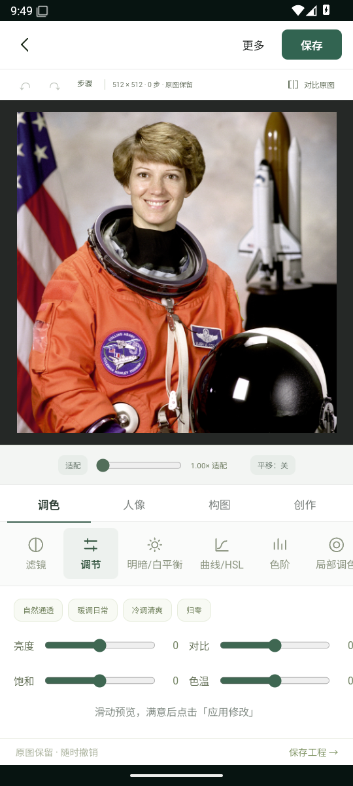

# 性能、界面与多照片回归

## 2026-10-25：0.3.3 首页与弹窗

`0.3.3-dev` / versionCode 8，最终应用源码 `1058180`，重排首页入口、联网 AI 与保存弹窗，并修正首屏图标。没有修改修肤／抠图算法；下方真实照片缺陷继续有效。当前说明见[首页与弹窗记录](SURFACE-STYLE-QUALITY.md)，[两 ABI 构建报告](quality/surfaces-build-20261025.json)核对了 95 个打包资源。

[最终运行40120891206](https://github.com/shiyan688/mint-photo/actions/runs/40120891206)的[原始报告](quality/surfaces-android-20261025/report.json)通过 278 条检查、53 次模拟器触摸命中与 7 项独立保存 PNG 核对。环境为 API35 / x86_64、实际 WebView 与系统文件选择器、HTTPS 模拟服务；不是真实 AI、ARM 实体手机或全部功能验收。较早源码 `591b883` 的[浏览器记录](quality/surfaces-browser-20261025.json)仅记录 390 × 844 视口，不证明最终版本已通过多个尺寸。

本轮模拟器 12 次交替亮度输入到两个动画帧，中位 68.25ms、P95 132.29ms，含自动化开销，仅使用 512 × 512 方形样例。该数字不代表实体手机帧率或大图性能，也不与下方其他运行作提速／退化比较。浏览器文件上传桥异常未计入应用性能，恢复流程未计为通过；真实键盘、持续笔划、内存压力与真实供应商效果仍待验证。

## 历史：0.3.1 界面重做与完整流程回归（2026-10-25）

0.3.1-dev（versionCode 6）重做手机工作区：深色画布，顶部返回/撤销/重做/保存，底部四分类与横向工具；调节与人像改为保留独立参数值的单滑杆界面，缩放工具按需展开，人像基础滑杆前移。官方参考和4种浏览器尺寸记录见 [设计与界面验收](UI-DESIGN-RESEARCH.md)。

1686项逻辑测试通过，普通ARM安装包构建、lint、签名和16KiB对齐通过；[构建与94个打包资源校验](quality/ui-redesign-build-20261025.json)。[本轮Android原始证据](quality/android-ui-e2e-20261025/README.md)通过83项流程/布局检查和7项独立保存PNG核对。新增检查不代表新增功能或达到醒图水平。自动肤质与抠图算法没有在这轮修改，下面的真实照片缺陷仍然有效。

本轮模拟器12次亮度输入到两个动画帧，含自动化开销，中位61.15ms、P95 121ms。运行环境没有做受控前后对比，不能与下方历史数字比较得出提速或退化，也不是实体手机性能验收。

以下保留2026-10-24的历史工作台、算法和性能记录；旧图不是当前界面。

日期：2026-10-24。此记录为开发分支的实际变化，不代表已经达到醒图水平。

## 界面与工具选择

首页改为“开始修图”与调节、滤镜、人像、抠图、修复、裁剪、拼图、证件照八个常用入口。去掉大幅生成肖像、英文装饰文案、三张重复风格卡片；生成示例收在次级折叠项并注明非真实照片。AI、批量、换照片与作品库集中到“更多”，编辑器保留保存主按钮。编辑区使用深色照片背景、浅色工具面板和统一线性图标；滑杆、工具标签字号做了调整。

参考的是日常修图的操作组织方式，没有复制醒图商标或素材。浏览器实际检查了首页、导入公共示例、分类/调节入口；以下是应用截图，非设计稿。Android API35模拟器中的布局、真实触屏涂抹与保存闭环也已通过；不代表实体手机验收。

## 性能改动与验证范围

1. 为滤镜/基础调节保留一份当前预览缓存，依据参数与已应用画布身份失效；同参数重复绘制不重算，参数、工具和历史改变后重算。
2. 对普通预览、原图对比的临时画布明确缩小释放，显示画布尺寸不变时复用像素缓冲，绘制前清空，避免半透明结果叠加。
3. `ImageData`本身使用`Uint8ClampedArray`，移除每像素重复的六次Math.min/max调用。12组旧算法黄金哈希覆盖全部滤镜和基础调节组合，输出逐字节相同。
4. AI弹窗固定宽度曾覆盖手机规则，安卓截图暴露画布/关闭按钮越界；现改为随视口收缩，并检查真实触屏坐标。移除处理遮罩的全屏背景模糊，减少额外合成开销（尚无该项单独性能量化）。
5. AI涂抹预览合并到requestAnimationFrame，并复用同尺寸画布；只影响界面刷新，发送时的选区仍由完整笔划生成。输入说明留出自动提示词长度余量。

已运行1676项公开回归、2项真实Canvas缓存/失效测试。额外的30帧固定滤镜重复预览实验中，新增临时大画布数量从30变为0，输出像素哈希一致。主机受控harness中位耗时267.83ms→0.083ms，但这是**缓存命中后的重复帧**，不是首次渲染、连续变参滑杆或安卓整机速度，也不是3000倍性能宣传。画布像素容量统计不等于进程RSS或已证实的浏览器内存泄漏。

[完整测量条件与结果](quality/preview-cache-performance-20261024.json)。复现需`@napi-rs/canvas`和CJK字体，运行`node tools/measure-preview-performance.cjs`与`node --test tests/native-canvas/preview-cache.test.cjs`。首次大图修肤、连续滑杆的安卓帧率、内存峰值仍未验收。

## 更多真实照片

在已有Collins照片外，新增Chawla办公室、Jemison侧脸工作场景、Melvin正式肖像，共4张NASA真实照片；下载原文件SHA256固定，未使用历史私人QA包。新运行官方MediaPipe 0.10.21 Windows CPU模型，然后用产品实际旧修肤/detail-v2和原抠图/边缘贴合引擎出图。没有借用旧检测结果，也没有伪造关键点。

|样例|新检测人脸|本轮观察|仍未解决|
|---|---:|---|---|
|Chawla|1|旧/新修肤均有实际像素变化|办公背景有残留，头发轮廓不精细|
|Collins|1|新检测与旧主机夹具不同，已单独记录|手持物和衣服边缘有错误，不能当跨运行时一致性证据|
|Jemison|0|侧脸未检出，修肤原样跳过|侧脸覆盖未完成；人物分割也有边缘缺陷|
|Melvin|1|皮肤和背景均有实际输出|手持头盔被误抠、背景出现零散残留，边缘贴合不能恢复语义遗漏|

修肤差异较小；没有准确抠图真值、无醒图同图输出或审美盲评，因此不把像素变化称为质量提升。试验标记保留，以上缺陷继续在台账中。照片仅用于信息性软件QA，不表示NASA或人物为应用背书。[来源与原文件哈希](quality/photo-batch-20261024/sources.json)、[新推理记录](quality/photo-batch-20261024/inference-summary.json)、[输出记录](quality/photo-batch-20261024/report.json)。

复现：`python tools/fetch-public-qa-photos.py` → 在单独的MediaPipe环境运行`tools/infer-photo-quality-batch.py --inputs .work/public-photo-qa/inputs --output .work/public-photo-qa/inference` → `node tools/render-photo-quality-batch.cjs`。模型推理环境：Python3.12、mediapipe0.10.21、numpy1.26.4、Pillow11.3.0、jax/jaxlib0.4.35、opencv-contrib-python4.11.0.86；主机推理不表示安卓数值或性能一致。

## 安卓闭环状态

使用独立`.e2e`应用包和一次性测试CA，普通debug/release包不包含测试信任配置。测试走实际Android WebView、原生HTTPS、模拟供应商、真实系统DocumentsUI保存和再次打开；模型返回为明确的合成负对照，不是真实AI效果。完整运行最终通过34项检查：自填测试配置→实际涂抹消除→服务返回→接受为新照片→系统保存→重新打开，以及扩图、401、比例错误、取消后重试、首页内置示例。Pillow独立检查设备保存PNG另有7项通过。消除保护像素、扩图原中心、保存与重开在该不透明512样例均为零差异。[原始报告、保存文件、蒙版与截图](quality/android-ai-e2e-20261024/README.md)。真实API服务与实体手机验收仍未开展。

安卓中间检查已确认一次消除预览的257654个保护像素与实际发送PNG一致，但同次编辑预览与发送图有2549个像素不同，最大通道差2/255。差异发生在请求前的图像路径，不归因为生成结果或已完成颜色精度优化；不宣称预览到发送逐字节相同。[失败运行与限定通过记录](quality/android-ai-partial-20261024.json)保留完整闭环FAIL状态，后续复测不能覆盖这次事实。

修复前，更严格的重开检查还发现保存PNG相对合成预览有2843个不同像素，最大差2/255，保护区域也有2927个像素不同；[该次失败记录](quality/android-save-rounding-before-20261024.json)继续保留。修复将文档/AI处理缓冲在首次创建上下文时声明`willReadFrequently`，避免在绘制后才申请频繁读回；这是[Canvas标准的读回提示](https://html.spec.whatwg.org/multipage/canvas.html)，并非跨设备CPU/GPU结果保证。最终该样例的预览/发送/保存/重开复测均零差异；这不是所有运行时或透明图的无损保证。

最终模拟器12次交替亮度输入到两帧的中位数53.75ms，p95约125.79ms，仍有波动；使用512×512图片与软件GPU，不转换为真机FPS、不与不同CI机器的旧耗时做倍数比较。首次大图、持续笔划、长时间内存、软键盘、弱网/切后台与ARM实体手机继续未验收。

额外修复：首页内置图片经固定白名单的原生PNG接口载入，拒绝路径/未知ID，保留文件访问禁用和既有存储origin；没有开放任意用户文件读取。模拟服务曾在取消未完成上传时崩溃，现处理连接中断，并用独立TLS取消→健康检查→再次multipart请求回归；旧代码负对照确实触发ECONNRESET，新代码通过。此项是测试服务修复，不是AI效果提升。
