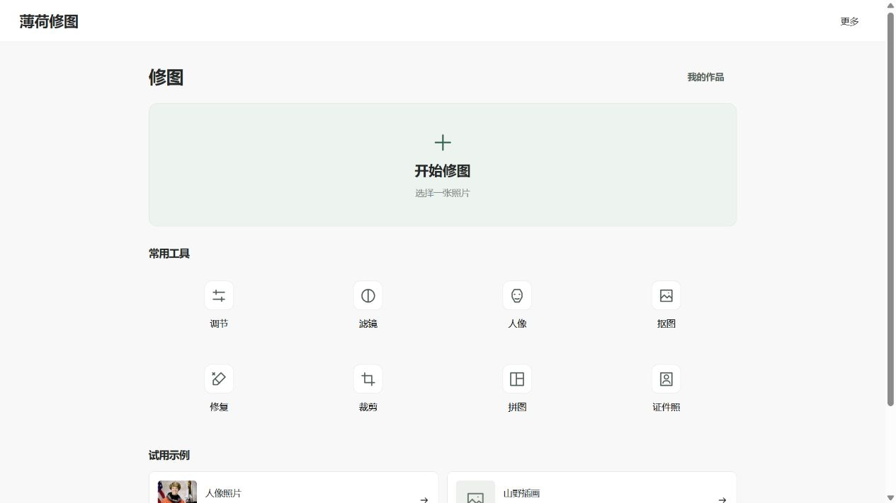
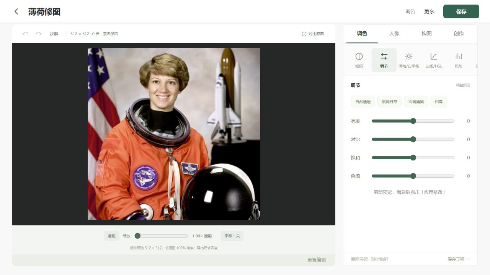
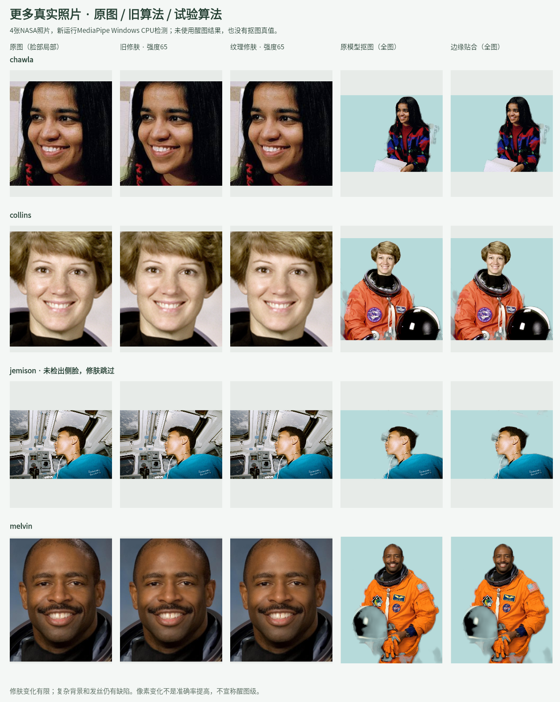

# 性能、界面与多照片回归

日期：2026-10-24。此记录为开发分支的实际变化，不代表已经达到醒图水平。

## 界面与工具选择

首页改为“开始修图”与调节、滤镜、人像、抠图、修复、裁剪、拼图、证件照八个常用入口。去掉大幅生成肖像、英文装饰文案、三张重复风格卡片；生成示例收在次级折叠项并注明非真实照片。AI、批量、换照片与作品库集中到“更多”，编辑器保留保存主按钮。编辑区使用深色照片背景、浅色工具面板和统一线性图标；滑杆、工具标签字号做了调整。

参考的是日常修图的操作组织方式，没有复制醒图商标或素材。浏览器实际检查了首页、导入公共示例、分类/调节入口；以下是应用截图，非设计稿。手机布局与触控仍需安卓运行截图和闭环测试验证。

## 性能改动与验证范围

1. 为滤镜/基础调节保留一份当前预览缓存，依据参数与已应用画布身份失效；同参数重复绘制不重算，参数、工具和历史改变后重算。
2. 对普通预览、原图对比的临时画布明确缩小释放，显示画布尺寸不变时复用像素缓冲，绘制前清空，避免半透明结果叠加。
3. `ImageData`本身使用`Uint8ClampedArray`，移除每像素重复的六次Math.min/max调用。12组旧算法黄金哈希覆盖全部滤镜和基础调节组合，输出逐字节相同。
4. AI涂抹预览合并到requestAnimationFrame，并复用同尺寸画布；只影响界面刷新，发送时的选区仍由完整笔划生成。输入说明留出自动提示词长度余量。

已运行1676项公开回归、2项真实Canvas缓存/失效测试。额外的30帧固定滤镜重复预览实验中，新增临时大画布数量从30变为0，输出像素哈希一致。主机受控harness中位耗时267.83ms→0.083ms，但这是**缓存命中后的重复帧**，不是首次渲染、连续变参滑杆或安卓整机速度，也不是3000倍性能宣传。画布像素容量统计不等于进程RSS或已证实的浏览器内存泄漏。

[完整测量条件与结果](quality/preview-cache-performance-20261024.json)。复现需`@napi-rs/canvas`和CJK字体，运行`node tools/measure-preview-performance.cjs`与`node --test tests/native-canvas/preview-cache.test.cjs`。首次大图修肤、连续滑杆的安卓帧率、内存峰值仍未验收。

## 更多真实照片

在已有Collins照片外，新增Chawla办公室、Jemison侧脸工作场景、Melvin正式肖像，共4张NASA真实照片；下载原文件SHA256固定，未使用历史私人QA包。新运行官方MediaPipe 0.10.21 Windows CPU模型，然后用产品实际旧修肤/detail-v2和原抠图/边缘贴合引擎出图。没有借用旧检测结果，也没有伪造关键点。

|样例|新检测人脸|本轮观察|仍未解决|
|---|---:|---|---|
|Chawla|1|旧/新修肤均有实际像素变化|办公背景有残留，头发轮廓不精细|
|Collins|1|新检测与旧主机夹具不同，已单独记录|手持物和衣服边缘有错误，不能当跨运行时一致性证据|
|Jemison|0|侧脸未检出，修肤原样跳过|侧脸覆盖未完成；人物分割也有边缘缺陷|
|Melvin|1|皮肤和背景均有实际输出|手持头盔被误抠、背景出现零散残留，边缘贴合不能恢复语义遗漏|

修肤差异较小；没有准确抠图真值、无醒图同图输出或审美盲评，因此不把像素变化称为质量提升。试验标记保留，以上缺陷继续在台账中。照片仅用于信息性软件QA，不表示NASA或人物为应用背书。[来源与原文件哈希](quality/photo-batch-20261024/sources.json)、[新推理记录](quality/photo-batch-20261024/inference-summary.json)、[输出记录](quality/photo-batch-20261024/report.json)。

复现：`python tools/fetch-public-qa-photos.py` → 在单独的MediaPipe环境运行`tools/infer-photo-quality-batch.py --inputs .work/public-photo-qa/inputs --output .work/public-photo-qa/inference` → `node tools/render-photo-quality-batch.cjs`。模型推理环境：Python3.12、mediapipe0.10.21、numpy1.26.4、Pillow11.3.0、jax/jaxlib0.4.35、opencv-contrib-python4.11.0.86；主机推理不表示安卓数值或性能一致。

## 安卓闭环状态

使用独立`.e2e`应用包和一次性测试CA，普通debug/release包不包含测试信任配置。测试走实际Android WebView、原生HTTPS、模拟供应商、真实系统DocumentsUI保存和再次打开；模型返回为明确的合成负对照，不是真实AI效果。目前正在执行与修正验收脚本，成功结果取得前不标记通过。真实API服务和实体手机验收仍未开展，用户已选择先完成模拟服务闭环。
